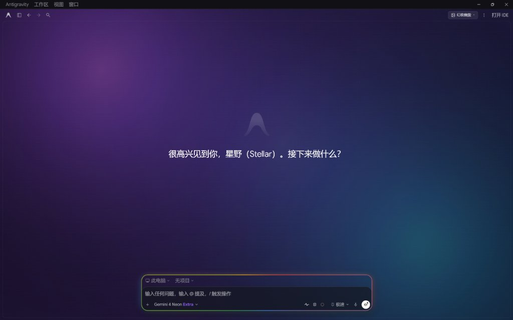
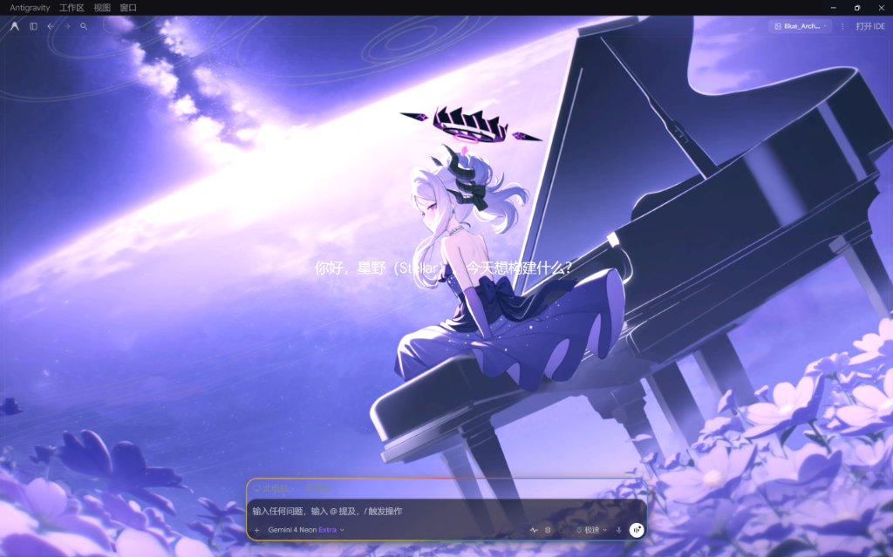

# Antigravity Suite（反重力四合一增强套件）

> 专为 **Google Antigravity (Windows v2.34+ / v2.35+)** 打造的一站式增强套件：
> **自定义壁纸与主题工坊 + Apple 级 120fps 推理等级滑条 + 底栏额度/速度仪表盘 + 零冲突一键汉化 + 官方更新自动重装。**

---

## 效果预览

| 内置「幻夜幽紫」毛玻璃预设 | 自定义本地 4K 壁纸（支持任意本地图片） |
| :---: | :---: |
|  |  |

---

## 核心特性

### 1. 自定义壁纸与毛玻璃主题工坊（原创 · 零 Bug · 120fps）
- **支持任意本地图片**：JPG / PNG / WebP / GIF / AVIF 拖入或点击上传，通过 Electron 主进程本地壁纸库（`wallpapers/`）原画质持久化保存，重启不丢。
- **7 套精选渐变预设**：暗夜极光、深海晴空、幻夜幽紫、幽谷碧波、熔岩暮色、**丝绒酒红 / 丹霞绯红**，以及一键切回官方原版。
- **全局自适应主题强调色**：内置预设与**任意自定义本地图片**都会自动提取协调主色调，联动点亮侧边栏选中胶囊、输入框聚焦光环、发光发送按钮、三段渐变悬浮滚动条、对话导航圆点与 Markdown 引用块。
- **高可读性深色终端调色板**：内置 WCAG ≥ 4.55:1 高对比 xterm ANSI 16 色配色，开启壁纸时终端日志依然清晰锐利。
- **Apple macOS / iOS 级物理滑块 + 预烘焙静态画布渲染**：
  - 壁纸模糊（Blur）与亮度直接预烘焙至离屏 Canvas，**零实时 CSS `filter: blur()`**、**零聊天气泡/输入框 `backdrop-filter`**；
  - 3 层独立 GPU `will-change: opacity` 面板底漆板 + `translate3d` 物理滑块，拖动 4 根滑条全程满帧 120fps 丝滑；
  - **彻底告别老主题插件的「模型菜单点不动 / 卡死」Bug**：绝不篡改 `:root --background`、绝不触碰 `[data-base-ui-portal]` / `[role="menu"]` / `z-index: 99999` / `:has()`。

### 2. Apple 级 120fps 推理等级滑条
- 在模型选择菜单底部提供可视化的推理等级滑条（Low / Medium / High / Extra 等档位），支持流光星空渐变视觉。
- 深度性能优化：全 GPU `translate3d` 滑块 + 固定宽度 `clip-path` 揭示 + 抬手延迟提交 React 状态 + 临界阻尼弹簧回弹，并与汉化引擎物理隔离，拖动零掉帧。

### 3. 底栏实时额度 / 速度 / 上下文仪表盘
- 集成 `antigrative-dashboard` (`antigravity-pulse`)，自动为 `languageServer.js` 补齐本地凭据参数并以调试端口拉起，实时显示 token/s 速度、5 小时 / 周额度进度与上下文占用率。

### 4. 一键中文汉化（零冲突自动集成）
- 遵循原作者版权声明，本仓库**不二次打包分发**汉化源码；首次安装时自动从原作者官方 GitHub 仓库拉取原版，并在本机应用 2 行免疫补丁（跳过 `data-ag-localization-skip` 区域），彻底消除汉化与滑条/壁纸之间的 DOM 冲突。

### 5. 防更新丢失 & 安全兜底机制
- **智能启动器**：通过桌面 `Antigravity (增强版)` 快捷方式启动；平时秒开，一旦检测到 Antigravity 官方自动升级了新版本，自动备份新版原版 `app.asar` 并重新注入全部四件套。
- **企业级安全校验**：每次写入前自动备份当前版本官方原版 `app.asar`，注入后执行 `node --check` 语法门禁 + 全部条目 SHA-256 逐字节完整性校验；任何一步异常都会**自动秒级回滚至官方原版**，绝不损坏软件。

---

## 环境要求

- **操作系统**：Windows 10 / 11 (x64)
- **Antigravity 客户端**：已安装官方 Windows 版（已实测支持 `v2.34.0` / `v2.35.1` / `v2.35.2`）
- **运行环境**：
  - [Python 3.10+](https://www.python.org/)（已加入 PATH）
  - [Node.js 18+](https://nodejs.org/)（已加入 PATH）

---

## 快速开始（30 秒上手）

1. **下载本仓库**（`git clone` 或点击右上角 `Code → Download ZIP` 解压到任意不含中文特殊符号的目录）。
2. **双击运行 `agy_menu.bat`**，按提示操作：
   - 输入 **`1`**：一键装入全部 4 项增强并启动 Antigravity（首次运行会自动从 GitHub 拉取官方汉化组件）。
   - 输入 **`7`**：在桌面生成 **`Antigravity (增强版)`** 智能启动快捷方式。
3. **日常使用**：以后直接双击桌面的 **`Antigravity (增强版)`** 启动即可（也可将其拖入任务栏 / Nexus Dock）。

### 命令行用法

```bash
# 查看当前版本与 4 项增强状态
python agy_suite.py status

# 一键安装全部 4 项增强并启动 Antigravity
python agy_suite.py patch --launch

# 智能启动（已注入则秒开；若官方刚更新则自动重注入后启动）
python agy_suite.py launch

# 创建桌面智能启动快捷方式
python agy_suite.py setup-shortcut

# 一键还原当前版本的官方原版 app.asar
python agy_suite.py restore
```

---

## 官方更新后怎么办？

1. 正常允许 Antigravity 官方自动更新（或手动覆盖安装新版）；
2. 更新完如果弹出了英文原版窗口，先关掉它；
3. 双击桌面的 **`Antigravity (增强版)`**（或运行 `agy_menu.bat` 选 `2`），脚本会自动检测新版本并把四件套重新注入，**你的本地壁纸和参数全部保留**。

---

## 目录结构

```text
Antigravity-Suite/
├── agy_suite.py                 # 统一管理器、SHA-256 校验与智能启动器
├── agy_menu.bat                 # Windows 交互式一键菜单
├── launch_agy.vbs               # 静默无黑框智能启动包装器
├── apply_slider_inplace.cjs     # asar 原地补丁器（滑条 + 壁纸工坊 + 额度凭据）
├── mods/
│   ├── wallpaper/               # 原创自定义壁纸与毛玻璃主题工坊（120fps）
│   ├── effort-slider/           # 深度优化 120fps 推理等级滑条（MIT）
│   └── dashboard/               # 底栏额度/速度仪表盘插件（MIT）
├── wallpapers/                  # 你的本地自定义壁纸与配置文件目录
└── backups/                     # 自动生成的各版本官方 app.asar 原版备份
```

---

## 致谢与开源协议

本套件原创部分（自定义壁纸与主题工坊、四合一安全管理与智能启动框架）采用 **MIT License** 开源。

诚挚感谢以下优秀开源项目的作者与贡献者：
- **一键汉化**：[QingniaoDawn/Antigravity-YiJianHanHua](https://github.com/QingniaoDawn/Antigravity-YiJianHanHua)（按原作者版权声明，本仓库不二次分发其文件，安装时从官方仓库按需拉取）
- **推理等级滑条**：[LLYSH-HANNARI/antigravity-Codex-Claude-effort-slider](https://github.com/LLYSH-HANNARI/antigravity-Codex-Claude-effort-slider)（MIT License，本项目在其基础上进行了 120fps GPU 动画与零冲突隔离重构）
- **额度/速度仪表盘**：[ATtacK030130/antigrative-dashboard](https://github.com/ATtacK030130/antigrative-dashboard)（MIT License）

> **免责声明**：本项目为第三方社区增强工具，与 Google 无关。工具会自动备份原版 `app.asar` 并支持随时一键 `restore` 还原。
